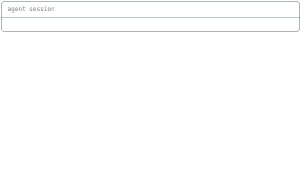

<picture><source media="(prefers-color-scheme: dark)" srcset="assets/hero-dark.gif"></picture>

Building and maintaining production apps for real businesses, from planning to support.\
I work in a fast loop with modern AI tools, and I own what ships.

**What I do**

```ruby
lucas = {
  web:      ["Rails", "Hotwire", "PostgreSQL", "APIs"],
  ai:       ["agents in daily work", "AI tools for the team"],
  product:  ["PRDs", "RFCs", "planning with the team"],
  delivery: ["integrations", "payments", "production support"]
}
```

**Lately**
- [pii-tokens](https://github.com/oLucasAguilar/pii-tokens): keeps Brazilian personal data out of Claude Code's context
- 20+ agent skills for code review, bug triage and writing
- [stoplight #601](https://github.com/bolshakov/stoplight/pull/601): dashboard fix in a Ruby gem

**How I work**

<picture><source media="(prefers-color-scheme: dark)" srcset="assets/flow-dark.gif"></picture>
